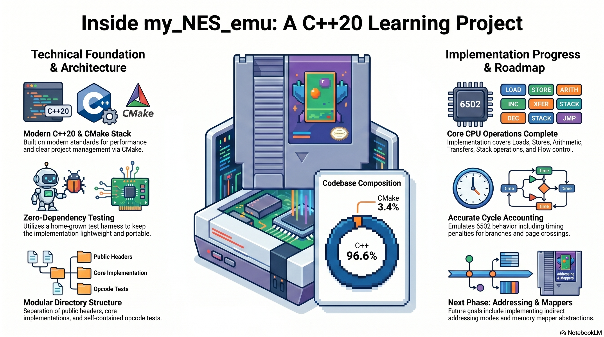

# NES Emulator (Learning Project)



This repo is a clean starting point for a Nintendo Entertainment System
emulator written in C++20. It focuses on clarity and testability so you can
understand how each subsystem works while you build it up incrementally.

## Stack
- CMake for builds
- C++20
- Tiny home-grown test harness (`tests/test_framework.*`) to keep dependencies
  zero; swap in your preferred framework later if desired.

## Layout
- `include/` public headers (`cpu.h`, `bus.h`, `cartridge.h`, `validation.h`, `types.h`)
- `src/` CPU, bus, mapper-0 cartridge loader, trace validator, and CLI
- `tests/` self-contained test runner and opcode tests
- `roms/` (create later) place test ROMs like `nestest.nes`

## Building
```
cmake -S . -B build
cmake --build build
```

Run tests:
```
cmake --build build --target cpu_tests
./build/cpu_tests   # or build\\Debug\\cpu_tests.exe on Windows
```

## Current CPU coverage
Implemented official opcodes with instruction-level cycle counting:
- Loads/stores: `LDA`, `LDX`, `LDY`, `STA`, `STX`, `STY`
- Arithmetic/logical/comparison: `ADC`, `SBC`, `AND`, `ORA`, `EOR`, `CMP`, `CPX`, `CPY`, `BIT`
- Shifts/rotates: `ASL`, `LSR`, `ROL`, `ROR`
- Increment/decrement: `INC`, `DEC`, `INX`, `INY`, `DEX`, `DEY`
- Transfers/stack: `TAX`, `TAY`, `TXA`, `TYA`, `TSX`, `TXS`, `PHA`, `PLA`, `PHP`, `PLP`
- Flow: absolute/indirect `JMP`, `JSR`, `RTS`, all eight branches, `BRK`, `RTI`
- Flag operations and official `NOP`
- Indexed and indirect addressing modes, including zero-page wrapping and the indirect-JMP wrap bug

Normal `cpu.step()` retains the placeholder NOP behavior for unimplemented
opcodes; the trace validator rejects them before executing.

Status flags and cycle accounting follow 6502 behavior (branch adds 1 when
taken, another +1 on page crossing).

## CPU trace validation (Step 3)

Place a locally obtained `nestest.nes` and matching canonical `nestest.log`
in `roms/` (not included in this repository). From the project root:

```sh
./build/nes_emulator --nestest roms/nestest.nes roms/nestest.log
# Windows multi-configuration builds:
./build/Debug/nes_emulator.exe --nestest roms/nestest.nes roms/nestest.log
```

An optional positive instruction limit validates a prefix:

```sh
./build/nes_emulator --nestest roms/nestest.nes roms/nestest.log 5000
```

The runner starts at `0xC000` with A/X/Y=0, P=`0x24`, SP=`0xFD`, and
compares **pre-instruction** PC, A, X, Y, P, SP and CYC for every record.
Canonical logs include seven reset cycles; validation adds this offset
without changing the CPU's existing zero-based cycle counter. PPU fields,
disassembly and printed instruction bytes are not compared.

Validation ends at EOF or the requested limit. Success describes only the
matched portion of the supplied log. A state mismatch, malformed/empty log,
I/O error or unsupported opcode returns a nonzero exit code; mismatches
include the line number and expected/actual state. The full standard log
includes unofficial opcodes, so full-log success is **not yet expected**.
A prefix ending before those instructions can be used to check official opcodes.

The cartridge loader supports standard iNES mapper 0/NROM with 16/32 KiB
PRG ROM and 8 KiB CHR ROM (or zero-initialized CHR RAM). It rejects NES 2.0,
VS/PlayChoice images, other mappers, trainers, invalid sizes and truncated
images. In cartridge mode, the bus mirrors 2 KiB internal RAM and protects
PRG ROM from writes; the lower cartridge space is a simple RAM placeholder.
Without a cartridge, the bus retains flat writable memory for CPU tests.
Bus reset clears RAM but retains the inserted ROM. No PPU/APU or persistent
battery-backed RAM is implemented yet.

All automated tests use synthetic data; no external ROM is needed:

```sh
cmake --build build --target check
ctest --test-dir build -C Debug --output-on-failure
```

On Windows, Visual Studio's IDE is optional. CMake plus the installed MSVC
build tools can build from a terminal. If `cmake` is unavailable, install
CMake or enable **C++ CMake tools for Windows** in Visual Studio Installer.

## Next steps
- Run local `nestest` reference validation and address any mismatches.
- Implement unofficial CPU opcodes for full-log validation.
- Add PPU/APU register behavior, interrupts, and system clocking.
- Extend cartridge support beyond mapper 0.

